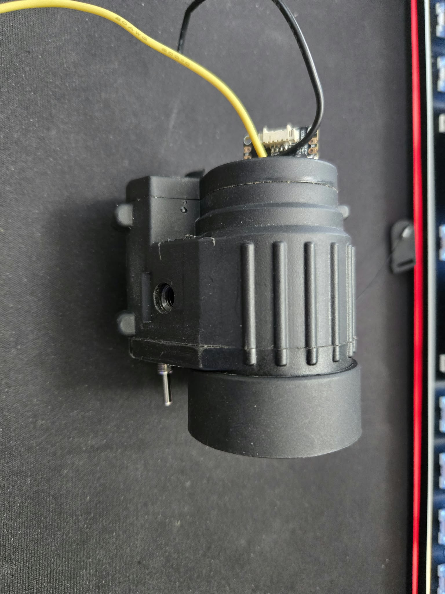

# DIY Thermal Night Vision

Turn a cheap USB-C phone thermal camera into a standalone thermal viewer
that boots in about a second. It needs no phone, no Raspberry Pi and no Linux.

The camera plugs into an **ESP32-P4** microcontroller. The P4 reads the video
over USB 2.0 High-Speed and shows a live thermal image (white-hot, black-hot or
ironbow, with a centre reticle) on a small round SPI LCD. It also forwards each
frame to a second, original ESP32 that turns it into **PAL composite video**.
That signal drives the micro-display eyepiece of an off-the-shelf digital
night-vision scope.


```
 ┌──────────────┐  USB 2.0 HS   ┌──────────────┐  SPI 20 MHz   ┌──────────────┐  CVBS   ┌───────────┐
 │ HIKMICRO     │  NV12 256x192 │ ESP32-P4     │  luma frames  │ ESP32        │  PAL    │ Eyepiece  │
 │ Mini2Plus V2 ├──────────────►│ (Pico/NANO)  ├──────────────►│ (WROOM / D1  ├────────►│ micro-    │
 │ thermal cam  │   25 fps      │              │  + handshake  │  Mini32)     │  GPIO25 │ display   │
 └──────────────┘               └──────┬───────┘               └──────────────┘         └───────────┘
                                       │ SPI 40 MHz
                                       ▼
                                ┌──────────────┐
                                │ GC9A01 240x240│
                                │ round LCD    │
                                └──────────────┘
```

**Status:** working on hardware. The full chain (camera → P4 → round LCD,
and P4 → ESP32 → composite eyepiece) runs at the camera's full **25 fps**.
The SPI link runs with zero errors. Everything is built into the scope
housing and runs from an internal LiPo. Still to come: a battery cover, a
measured runtime and a zoom button. See [Build photos](#build-photos).

---

## Why an ESP32-P4?

The project started on a Raspberry Pi, which works but takes a long time to
boot. A microcontroller boots almost instantly. However, the camera streams
about 1.8 MB/s of video. The ESP32-S3's USB host is Full-Speed only (12 Mbit/s,
in practice well under 1.5 MB/s), so it can't keep up. The **ESP32-P4** has a
USB 2.0 **High-Speed** (480 Mbit/s) host, plus 32 MB of in-package PSRAM, which
is plenty for frame buffers.

## Why a second ESP32 for composite?

Many cheap digital night-vision scopes and monoculars use a tiny micro-display
fed by a **composite video** input. In the scope used here, that input goes
through a TVP5150 decoder and an FPGA scaler. The original ESP32 (not the S2,
S3, C3 or P4) has an internal 8-bit DAC, and the
[ESP_8_BIT_composite](https://github.com/Roger-random/ESP_8_BIT_composite)
library uses it to generate colour PAL or NTSC with **no extra components**:
GPIO25 connects straight to the eyepiece's video input. The P4 has no DAC, so
a cheap ESP32 board does the job as a "video card".

---

## Hardware

| Part | Notes |
|---|---|
| **HIKMICRO Mini2Plus V2** | 256×192 VOx sensor, 25 Hz, USB-C. Enumerates as a standard UVC camera. Other UVC thermal dongles may work (see [Adapting to another camera](#adapting-to-another-camera)). |
| **Waveshare ESP32-P4-Pico** (or **ESP32-P4-NANO**) | Both work. The Pico is smaller. The NANO has a full-size USB-A host port. |
| **GC9A01** 1.28" round 240×240 SPI LCD | Optional. A local preview / standalone viewer. |
| **Original ESP32** board | ESP32-WROOM DevKit or a "D1 Mini ESP32" (CH9102F). It must be the *original* ESP32 for the DAC. |
| A composite-input eyepiece | Here: the micro-display and driver board ("DB V1.3", TVP5150AM1 + Anlogic FPGA) from a digital night-vision scope. |
| USB cable for the camera | NANO: a USB-A → USB-C adapter. Pico: an MX1.25 4-pin → USB cable. **It must be short and well made**; see [Troubleshooting](#troubleshooting). |

### Wiring

#### Camera

- **NANO:** plug the camera into the **USB-A** port (USB-A → USB-C adapter).
- **Pico:** plug the camera into the **4-pin MX1.25 USB HS header**. Keep the
  cable short, with D+ and D− twisted together.

The camera is powered from the port's 5 V VBUS.

#### Round LCD (GC9A01) → ESP32-P4

These GPIO numbers are the same on both boards. Find them by GPIO number on
your board's printed pinout. Pins are `#define`d at the top of
[`src/display.c`](src/display.c).

| GC9A01 | ESP32-P4 |
|---|---|
| SCL / SCLK | GPIO20 |
| SDA / MOSI | GPIO21 |
| CS | GPIO22 |
| DC | GPIO23 |
| RST | GPIO32 |
| BL | GPIO33 |
| VCC | 3V3 |
| GND | GND |

#### ESP32-P4 → composite ESP32 (SPI link)

| Signal | P4-**Pico** | P4-**NANO** | Dir | ESP32 (composite) |
|---|---|---|---|---|
| SCLK | GPIO14 | GPIO45 | → | IO18 |
| MOSI | GPIO15 | GPIO46 | → | IO23 |
| CS | GPIO16 | GPIO47 | → | IO5 |
| HANDSHAKE | GPIO17 | GPIO48 | ← | IO4 |
| GND | GND | GND | — | GND |

Use short wires and a solid ground; it's a 20 MHz clock. See
[`shared/link_protocol.h`](shared/link_protocol.h).

> **NANO warning:** GPIO39–48 on the ESP32-P4 are a separate I/O power domain,
> supplied by the chip's internal LDO4 (1.8 V by default). The original ESP32
> can't reliably read 1.8 V as a logic high, and on the NANO the link lost most
> of its clock edges. GPIO45 also switches the SD card's power. The Pico pins
> (14–17) are 3.3 V and run error-free at 20 MHz. On a NANO, move the link to
> other 3.3 V header pins if you can.

#### Composite ESP32 → eyepiece

| ESP32 | Eyepiece video input |
|---|---|
| GPIO25 (DAC1) | CVBS / video |
| GND | GND |

On the scope's 7-pin connector used here, those are **pin 3 (CVBS)** and
**pin 2/4/6 (GND)**. The other pins are power rails (3.5 V, 10.5 V, battery).
**Don't connect anything to them** until you know what they do.

### Power (in progress)

The build runs from a single LiPo cell. These are the parts being used (all
cheap modules):

| Part | Used here |
|---|---|
| Battery | 3.7 V 1300 mAh LiPo, size 883048 |
| Charger + protection | TP4056 module **with** protection (the DW01 + dual-MOSFET version with `OUT+`/`OUT−` pads) |
| 5 V supply | Mini DC-DC boost module, 3.7 V → 5–12 V adjustable, with LED |
| 3.3 V supply | AMS1117-3.3 step-down module (4.75–12 V in, 800 mA) |

```
 LiPo ── B+/B− ┐
               TP4056 (USB charge) ── OUT+/OUT− ── switch ── boost (set to 5.0 V) ──┬── ESP32-P4 5V pin (camera powered from its USB VBUS)
                                                                                    ├── composite ESP32 5V/VIN pin
                                                                                    └── AMS1117-3.3 ── eyepiece display board 3.3 V
 All grounds common.
```

Notes:

- **Set the boost converter to 5.0 V with a meter before connecting
  anything.** These adjustable modules often ship set higher, and 9–12 V would
  destroy the boards.
- Take the load from the TP4056's **`OUT+`/`OUT−`**, not `B+`/`B−`. Only the
  `OUT` pads go through the over-discharge protection.
- The AMS1117 needs about 1.1 V of headroom, so it must run from the 5 V rail,
  not straight from the battery.
- Typical TP4056 modules charge at 1 A (set by the `R_PROG` resistor). That's
  fine for a 1300 mAh cell.
- Unplug the battery supply, or switch it off, when a board is connected to a
  PC over USB for flashing. This avoids two 5 V sources fighting each other.
- **Runtime:** not yet measured. A rough estimate is 1.5–2 hours: about
  4.8 Wh in the cell, minus boost losses, with the camera, P4, ESP32 and
  eyepiece together drawing roughly 2–3 W. To measure the real draw, put a
  USB power meter on the 5 V rail.

---

## Build photos

### First tests

The first version ran on an ESP32-P4-NANO with the camera in its USB-A port
and a GC9A01 round LCD.


The composite ESP32 was then tested on the bench. Its DAC output (yellow wire)
went straight into the eyepiece's driver board, with the scope taken apart.


The test pattern on the eyepiece, in colour and in black and white. The camera
behind the eyepiece optics makes the photos look soft; the real image is
sharper.

| Colour | Black and white |
|---|---|
|  |  |

### Making the composite ESP32 smaller

The D1 Mini32 board was too big for the housing, so the ESP32 module was
removed from it with a DIY hot plate (a frying pan, never to be used for food
again). Only the bare module was kept.

**Flash the composite firmware before you remove the module.** Once it's off
its carrier board, there's no USB-serial chip to program it with.

| Before | After |
|---|---|
|  |  |

Pads on the underside of the module, used to wire it directly:


### Mounting it on the ESP32-P4-Pico

The bare module sits on the back of the Pico, wired with short sleeved leads.

| | |
|---|---|
|  |  |


### Fitting it into the scope

The LiPo cell and charger go in the scope's battery compartment, and the Pico
fits in the tube next to it.




### Camera mount

A 3D-printed extension on the front of the scope holds the camera, with a
USB-C charging socket on the side.


---

## Software

Two separate PlatformIO projects live in this repo:

| Folder | Board | Framework |
|---|---|---|
| `/` (root) | ESP32-P4 | ESP-IDF 5.5 via the community [pioarduino](https://github.com/pioarduino/platform-espressif32) platform. The official PlatformIO platform does not support the P4. |
| `composite/` | original ESP32 | Arduino core 2.0.14 (`espressif32@6.5.0`), because ESP_8_BIT_composite does not work on core 3.x |

### Building and flashing

Install [VS Code](https://code.visualstudio.com/) +
[PlatformIO](https://platformio.org/) and Git (pioarduino needs Git on PATH).

**ESP32-P4 firmware**

```sh
# ESP32-P4-Pico
pio run -e esp32-p4-pico -t upload
# ESP32-P4-NANO
pio run -e esp32-p4-nano -t upload

pio device monitor
```

> **Check your P4 chip revision.** Early Picos have **v1.x** silicon. On those
> the bootloader prints `ESP-ROM:esp32p4-eco2-...` and the boot log shows
> `chip revision: v1.x`. Binaries for v1.x and v3.x chips are **not**
> interchangeable. A v3 build on a v1 chip crashes immediately with
> `Illegal instruction`.
> The `esp32-p4-pico` env builds for v1.x
> ([`sdkconfig.defaults.pico`](sdkconfig.defaults.pico)), and the
> `esp32-p4-nano` env builds for v3.x. If your board differs, move the
> `CONFIG_ESP32P4_SELECTS_REV_LESS_V3=y` line accordingly. After changing any
> `sdkconfig.defaults*` file, delete the generated `sdkconfig.<env>` file.

**Composite ESP32 firmware**

```sh
pio run -d composite -e esp32dev -t upload     # ESP32 DevKit
pio run -d composite -e d1mini32 -t upload     # D1 Mini ESP32
pio device monitor -d composite
```

If an upload fails with "No serial data received", hold **BOOT** and tap **EN**.

### Using it

- Plug in the camera. The P4 detects it, selects the 256×192 NV12 mode and starts streaming.
- **Palette button:** the P4 BOOT button (GPIO35), or an external momentary push button wired from **GPIO2 to GND** (Pico; GPIO2 is not on the NANO header), cycles **white-hot → black-hot → ironbow**. The composite output follows.
- **Image orientation:** the P4 rotates the composite image 180° before
  sending it (`ROTATE_180` in [`src/composite_link.c`](src/composite_link.c)),
  because the eyepiece in this build is mounted upside down. Set it to `0` if
  yours isn't. The round LCD isn't affected; it has its own setting,
  `esp_lcd_panel_mirror()` in [`src/display.c`](src/display.c).
- With no frames from the P4 for one second, the composite ESP32 shows a test
  pattern (colour bars, grey ramp, reticle). In that mode its serial console
  accepts `p` (next palette) and `d` (toggle field dither).
- Both boards log once a second. The P4 logs camera fps, throughput, render
  time and link sent/dropped/timeout counts. The ESP32 logs received fps,
  chunks, and bad header/checksum/short/partial counts.

---

## How it works

### ESP32-P4 (`src/`)

| File | Role |
|---|---|
| [`camera.c`](src/camera.c) | USB host + UVC: enumerates the camera, logs its formats, selects **NV12 256×192 @ 25 fps**, streams into PSRAM buffers and handles hot-plug. |
| [`processing.c`](src/processing.c) | Takes the luma (Y) plane, crops a centred 192×192 square, **bilinearly** scales it to 240×240, maps it through a 256-entry RGB565 palette LUT and draws the reticle. |
| [`display.c`](src/display.c) | GC9A01 over SPI at 40 MHz with two DMA buffers, so the next frame renders while the previous one transfers. |
| [`composite_link.c`](src/composite_link.c) | SPI master in its own task. Sends each 256×192 luma frame to the composite ESP32. It drops frames rather than ever stalling the LCD. |
| [`input.c`](src/input.c) | Debounced palette buttons (BOOT on GPIO35, external on GPIO2) → palette change. |

The thermal image is only the **luma plane** of the NV12 stream. The camera's
other modes (YUY2 frames such as 256×344 and 256×196) carry raw temperature
data, which this project ignores.

### SPI link (`shared/link_protocol.h`)

Each frame is sent as **12 chunks**. Each chunk is an 8-byte header (magic,
frame sequence, chunk number, palette, 16-bit checksum) followed by 16 rows
(4104 bytes). The slave raises a **handshake** line whenever it has a DMA
buffer queued, and the master waits for that rising edge before each chunk.
This avoids overruns without needing a fast slave. At 20 MHz a frame takes
about 20 ms, comfortably inside the camera's 40 ms frame period.

### Composite ESP32 (`composite/`)

- [`link.cpp`](composite/src/link.cpp) is a VSPI slave with three queued DMA
  buffers. It reassembles and checksums the chunks into whole frames.
- [`main.cpp`](composite/src/main.cpp) maps luma to palette indices,
  stretches 192 → 240 rows bilinearly (PAL pixels are 1.25× wider than tall,
  so this gives a correct 4:3 picture) and draws the reticle.
- [`palettes.cpp`](composite/src/palettes.cpp) holds white-hot / black-hot /
  ironbow, with the same colour stops as the P4.

---

## Things that had to be fixed (useful if you hit them too)

These are marked `LOCAL PATCH` in the source.

1. **UVC frame index lookup.** In
   [`components/usb_host_uvc`](components/usb_host_uvc)
   (Espressif `usb_host_uvc` 2.6.0, vendored), the Mini2Plus numbers its frame
   descriptors non-sequentially: the NV12 frame is index 2, but the YUY2
   format has frames 1, 3, 4, 8 and 9. Stock code rejected any
   `bFrameIndex > bNumFrameDescriptors`, so every stream open failed with
   `Could not find requested frame format`.
2. **Payload headers leaking into the image.** The camera sends each frame as
   about 40 bulk payloads of 1862 bytes, each ending in a short packet. Stock
   code mis-tracked the header/data state, so every second 2-byte payload
   header ended up in the picture. Frames came out 40 bytes too long, with
   rows shifted into jagged "scan lines".
3. **Eyepiece froze on the first frame.** ESP_8_BIT_composite outputs 312-line
   *non-interlaced* PAL (every field identical). The eyepiece's FPGA scaler
   only updates on alternating odd/even fields, so it never showed a new
   frame. The vendored library now outputs **proper 625-line interlaced PAL**,
   with the correct half-line equalising and broad pulses.
4. **Thermal palettes on composite.** The library uses a fixed RGB332
   palette. A runtime `setPalette()` now generates the PAL colour tables for
   any 256-colour palette. The DAC only manages about 53 luma steps from black
   to white, so optional **field dithering** (round down on one field, up on
   the other) doubles the visible grey levels.
5. **USB descriptors bigger than the default limit.** UVC configuration
   descriptors are bigger than the default 256-byte control transfer, so
   `CONFIG_USB_HOST_CONTROL_TRANSFER_MAX_SIZE=4096` is needed. Without it the
   camera won't enumerate.

## Troubleshooting

| Symptom | Likely cause |
|---|---|
| `USBH: Dev 0 EP 0 Error` / `CHECK_SHORT_DEV_DESC FAILED` | USB signal integrity: the cable or adapter is too long, untwisted, or has D+ and D− swapped. 480 Mbit/s is unforgiving. Check VBUS too. |
| Stream stops when the cable is touched | Same: a marginal cable. Use a proper, short cable. |
| `Illegal instruction` right after `entry 0x...` | Wrong chip revision build (v1.x vs v3.x). See above. |
| Eyepiece shows only the test pattern | The composite ESP32 isn't receiving frames. Compare both boards' link counters: `timeouts` on the P4 means the handshake wire is bad; silence on the ESP32 means CS/SCLK are bad; `short`, `bad checksum` or `bad header` counts point to wiring quality or voltage levels. |
| Link only ~13 fps | Link clock too slow for 25 fps. Use 20 MHz (`LINK_CLOCK_HZ`). |
| Build: `invalid choice: 'esp32p4'` / `No module named 'esptool'` | The composite project's older platform overwrote pioarduino's esptool in `~/.platformio/packages/tool-esptoolpy`. Delete that folder and rebuild the P4 project. If needed, unpack pioarduino's esptool 5.4.0 release into it. |
| Build: `MissingPackageManifestError` | An interrupted package download. Delete that folder under `~/.platformio/packages` and rebuild. |

## Adapting to another camera

Set the `camera` log tag to DEBUG to dump the camera's UVC descriptors and
format list. Then change the format and resolution that
[`src/camera.c`](src/camera.c) looks for. As long as the camera offers a plain
8-bit image mode (NV12 or YUY2), only the luma bytes are needed.
`processing.c` and the composite link assume 256×192, so change
`LINK_WIDTH` / `LINK_HEIGHT` and the crop/scale if yours differs.

## To do

- Print a battery cover
- Measure the battery runtime
- Zoom (2× digital) on a second button
- NTSC output: the library supports it, but the interlacing patch was only done for PAL

---

## Credits and licence

- **Firmware and write-up:** written by **Claude** (Anthropic's AI model),
  working in Claude Code. The hardware was built and tested by the repository
  owner.
- **ESP_8_BIT_composite** by Roger Cheng (MIT), with roots in Peter Barrett (rossumur)'s
  ESP_8_BIT. Vendored with local patches in
  [`composite/lib/ESP_8_BIT_composite`](composite/lib/ESP_8_BIT_composite);
  its licence is in that folder.
- **usb_host_uvc** by Espressif (Apache-2.0). Vendored with local patches in
  [`components/usb_host_uvc`](components/usb_host_uvc); its licence is in that
  folder.
- **esp_lcd_gc9a01** by Espressif, fetched by the IDF component manager.

The project's own code is released under the [MIT licence](LICENSE).

[`CLAUDE.md`](CLAUDE.md) is the detailed engineering log kept during
development: measurements, dead ends and decisions, with dates.
